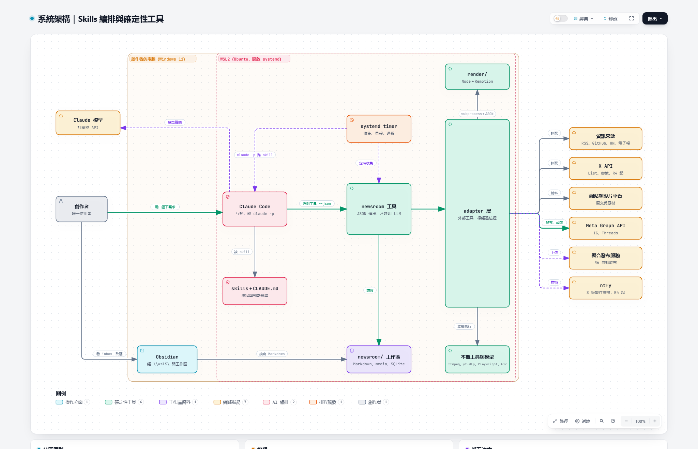
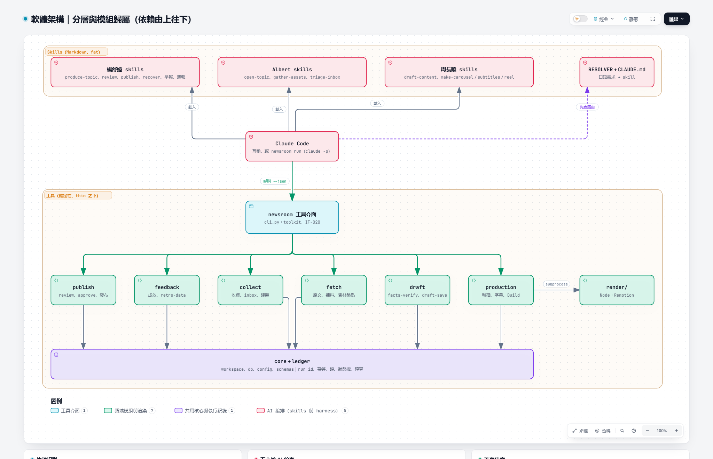
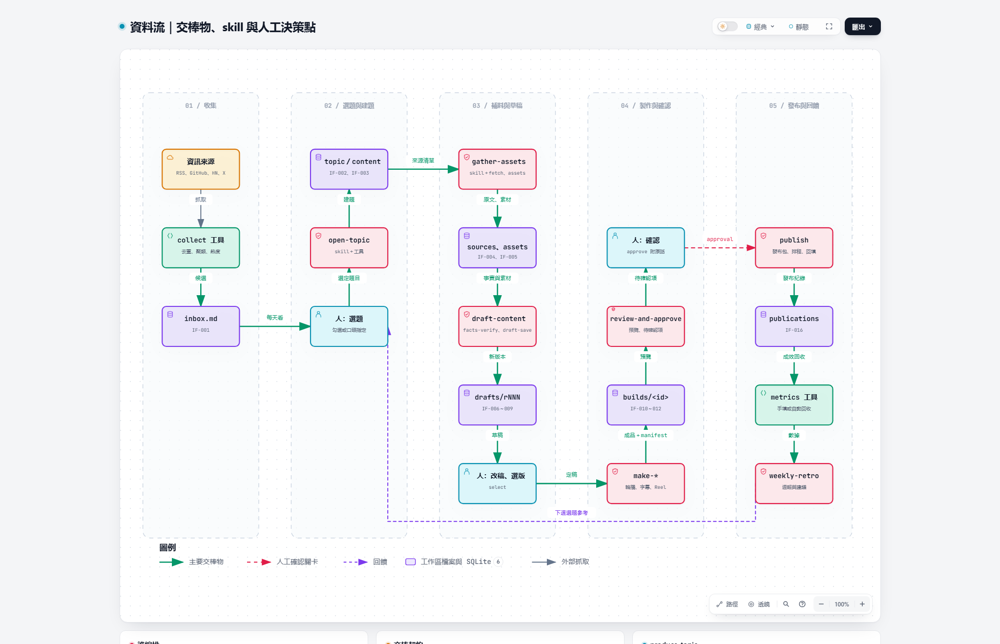
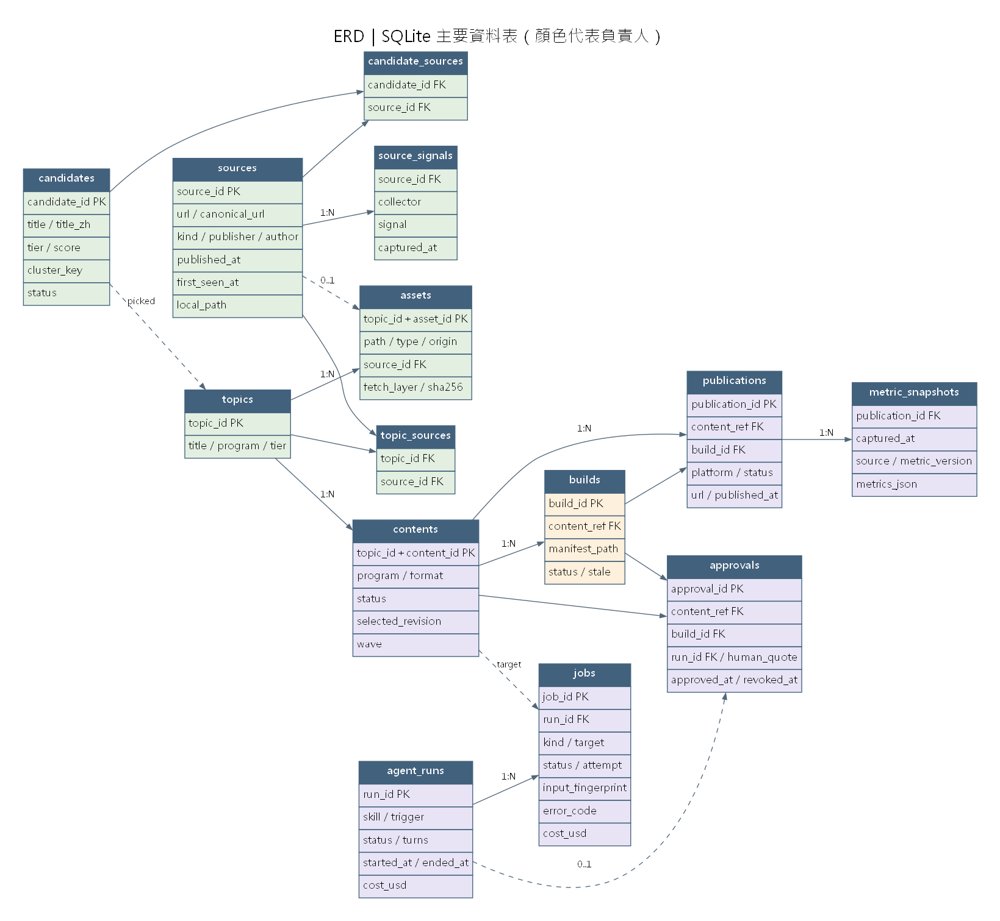

# 架構｜技術堆疊、系統架構、軟體架構

| 項目 | 內容 |
|---|---|
| 版本 | v1.1｜2026-10-24（編排改為 Skills＋AI agent，見 ADR-09） |
| 上游 | [PRD](../product/PRD.md)、[SRS](../spec/00_overview.md) |
| 圖檔原始碼 | 系統架構、軟體架構、資料流：`diagrams/*.architecture.json`／`*.dataflow.json`（archify）；ERD：`tools/draw_architecture.py`（Graphviz） |

---

## 1. 架構總覽

一句話：**單機、單使用者；AI agent 照 Markdown skill 編排，確定性的工作交給小工具。**

借用 [gbrain](https://github.com/garrytan/gbrain) 的「thin harness, fat skills」分層：

| 層 | 放什麼 | 本專案 |
|---|---|---|
| Skills（上） | 判斷、流程、口吻、取捨；用 Markdown 寫，像函式一樣帶參數呼叫 | `skills/<name>/SKILL.md`，例如 `produce-topic`、`draft-content`、`make-reel` |
| Harness（中，很薄） | 跑模型、讀寫檔案、管上下文、安全限制 | Claude Code（互動）與 `claude -p`（排程、無人值守）；不自己寫 |
| 工具（下） | 同樣輸入一定得到同樣結果的事：抓取、驗證、渲染、寫狀態、發布 | Python 套件 `newsroom` 與 Node `render/`，每個工具 JSON 進、JSON 出 |
| 資料 | 人寫的內容與執行紀錄 | 工作區 Markdown＋SQLite（不變） |

原則：**需要判斷的往上放進 skill，要求精確的往下放進工具，harness 保持很薄。** 人不再背指令，直接對 agent 說要做什麼（例如「把今天 inbox 第 3 題做成 Reel」）；agent 依 skill 決定要呼叫哪些工具、照什麼順序。

**不交給 AI 自己決定的事**（寫死在工具裡，skill 繞不過去）：
1. 發布前一定要有人工確認紀錄；沒有就拒絕（PUB-FR-003、AGT-FR-005）。
2. 冪等與不重複發文、不重複花錢：工具層的指紋、鎖與預算上限。
3. 狀態轉換只走狀態機；字幕時間、渲染規格、引用比對都是程式算，不是 LLM 猜。

不採用：微服務、訊息佇列、帳號系統、Web 後台、雲端工作流平台，也不自寫固定流程的協調器（ADR-09）。

## 2. 技術堆疊

| 層 | 技術 | 用途 | 選型依據 |
|---|---|---|---|
| 介面 | Markdown＋Obsidian | 人讀寫 inbox、稿件、筆記 | PRD D5 |
| 入口 | Claude Code（互動）、`claude -p`（排程） | 人用自然語言下需求；agent 依 skill 編排 | ADR-09、SRS 01 §2 |
| 編排 | Markdown skills＋工作區 `CLAUDE.md`（RESOLVER） | 每個環節的做法、判斷標準、交付物 | SRS 01 AGT-FR |
| 工具 | Python 3.11+、poetry、Typer（只當工具介面） | `newsroom <tool> --json`，給 agent 呼叫；人也能直接執行來除錯 | SRS 01 §2、IF-020 |
| 資料 | SQLite（WAL）＋sqlite-vec | 執行紀錄、候選、向量 | ADR-03 |
| 契約 | JSON Schema（draft 2020-12）＋Pydantic | 模組交接與設定驗證 | SRS 07 |
| 排程 | systemd timer（WSL）／cron | 收集、早報、成效回收、自我測試 | SRS 01 OPS |
| 收集 | feedparser、httpx、courlan、RapidFuzz、bge-m3 | 收集、正規化、聚類 | 技術選型 §1 |
| 補料 | trafilatura＋curl_cffi、Jina Reader、yt-dlp＋Deno、gallery-dl、Playwright | 原文、素材、錄影 | 技術選型 §1.5–1.6 |
| LLM | Anthropic SDK（Citations、structured output、prompt caching） | 事實抽取、寫稿、週報建議 | 技術選型 §2.1 |
| 字幕 | Qwen3-ForcedAligner、Breeze-ASR-25＋faster-whisper、CKIP、BudouX、pysubs2 | 對齊、比對、斷詞、分行 | 技術選型 §2.2–2.4 |
| 渲染 | Node（nvm）＋TypeScript＋Remotion（或 HyperFrames，見 ADR-04）；Playwright（輪播） | Reel、輪播 | 技術選型 §3 |
| 媒體 | ffmpeg／ffprobe | 前處理、faststart、規格檢查 | 技術選型 §3.4 |
| 發布 | Meta Graph API（IG、Threads）；聚合服務（R6） | 發布、成效 | 技術選型 §4 |
| 通知 | ntfy（＋Apprise） | 推播 | 技術選型 §1.7 |
| 容器 | Docker | changedetection.io、ntfy | 全域規範：外部服務一律用 Docker |
| 測試 | pytest、vcrpy／respx、jsonschema、Vitest（Node） | 離線測試、契約測試 | NFR-014 |

## 3. 系統架構圖（部署）



互動版：[system-architecture.html](../diagrams/system-architecture.html)（下載後用瀏覽器開）。

| 元件 | 執行位置 | 說明 |
|---|---|---|
| Claude Code | WSL2 | agent 執行環境；在工作區目錄啟動，讀 `CLAUDE.md` 與 `.claude/skills/` |
| newsroom 工具 | WSL2 | 確定性工具；由 agent 呼叫，systemd timer 也直接呼叫不需要判斷的工作（例如收集） |
| render/ | WSL2（Node） | 由 newsroom 工具以 subprocess 呼叫；只讀 manifest 指定的檔案 |
| 本機模型 | WSL2 | ASR、對齊、斷詞、嵌入；沒有 GPU 時以 CPU 執行 |
| newsroom/ 工作區 | WSL 檔案系統 | Obsidian 透過 `\\wsl$\` 路徑開啟同一個資料夾 |
| Docker 服務 | WSL2 | changedetection.io（R5）、ntfy（選用自架） |
| 外部服務 | 網路 | 都經過 adapter；每個都能單獨停用 |

**部署注意**
- WSL 要開啟 systemd（`/etc/wsl.conf`），並關閉 Windows 自動睡眠，否則排程會中斷（SRS OPS-FR-001、OPS-FR-002）。
- Obsidian 在 Windows 端，透過 `\\wsl$\` 開啟 WSL 內的工作區，比反過來（WSL 讀寫 `/mnt/c`）快。
- 金鑰放在 WSL 使用者的環境變數，或作業系統 keyring，不進工作區。

## 4. 軟體架構圖（分層與模組）



互動版：[software-architecture.html](../diagrams/software-architecture.html)（下載後用瀏覽器開）。

**依賴規則**（違反就不能合併）

1. 依賴方向由上往下：skills → 工具 → 領域 → core／adapter。skill 只能透過工具改變狀態，不能直接改 SQLite，也不能直接改受管區塊。
2. **領域模組之間不能互相 import。** collect、fetch、draft、production、publish、feedback 彼此只透過檔案（07 介面契約）與資料庫交接，這樣三個人才能各自開發。
3. 領域模組呼叫外部工具，一律經過 adapter 介面；adapter 的實作可以替換。
4. 唯一的共用程式碼在 `core`（workspace、db、config、log、schemas）與 `ledger`（執行紀錄、冪等、鎖、狀態機）。
5. 每個工具都是 JSON 進、JSON 出（IF-020），並把呼叫寫進執行紀錄（IF-014，帶 `run_id`）；會花錢或花時間的工具一律經過 ledger 的冪等、鎖與預算檢查。
6. 工具不呼叫 LLM。需要判斷或寫作的地方寫成 skill，由 agent 自己做；工具負責驗證 agent 的產出（例如 facts 的原文摘錄、草稿 schema、引用比對）。

### 4.1 程式碼目錄

```text
repo/
  pyproject.toml
  CLAUDE.md                        # 開發用；工作區用的 CLAUDE.md 由 init 產生
  skills/                          # Markdown skills（AGT-FR-001），init 時連結到工作區 .claude/skills/
    RESOLVER.md                    # 哪種需求先讀哪份 skill
    _conventions/                  # 共用規則：輸出格式、關卡、成本
    triage-inbox/  open-topic/  gather-assets/                    # Albert
    draft-content/  make-carousel/  make-subtitles/  make-reel/   # 周長曉
    produce-topic/  review-and-approve/  publish/  morning-brief/  weekly-retro/  recover/   # 楊舒媁
      SKILL.md  evals/             # 每個 skill 都有固定案例（AGT-FR-007）
  src/newsroom/
    cli.py                         # Typer entry; tool surface only (IF-020)
    core/                          # Albert: workspace, db, config, log, schemas loader
      workspace.py  blocks.py  frontmatter.py  db.py  migrations/  config.py  log.py
    ledger/                        # 楊舒媁: run_id, tool calls, fingerprint, lock, state machine
      runs.py  jobs.py  locks.py  state.py  step.py
    ops/                           # 楊舒媁: scheduler, headless runner, notify, budget, heartbeat
    collect/                       # Albert
      collectors/{manual,rss,github,hn,hf,newsletter,x,changedetect}.py
      normalize.py  cluster.py  score.py  inbox.py  topics.py  calendar.py
    fetch/                         # Albert
      extract.py  layers/{l1_api,l2_html,l3_dl,l4_record}.py  assets.py  selftest.py
    draft/                         # 周長曉: no LLM calls; verify and version agent output
      facts_verify.py  save.py  check.py  versions.py  script_parser.py
      templates/programs/*.md
    production/                    # 周長曉
      build.py  preprocess.py  spec.py  carousel.py
      subtitle/{align,asr,segment,linebreak,export}.py
      reel.py
    publish/                       # 楊舒媁
      review.py  approve.py  package.py  publishers/{base,instagram,threads,aggregator}.py  storage.py
    feedback/                      # 楊舒媁
      metrics/{base,manual,instagram,threads}.py  retro_data.py
  render/                          # 周長曉 (Node + TypeScript)
    src/cli.ts  src/reel/  src/carousel/  src/components/  src/tokens/
  schemas/*.schema.json            # 07 介面契約（三人共同）
  tests/
    fixtures/workspace/            # IF-018
    contract/                      # schema 驗證測試
    unit/  integration/
```

## 5. 資料流



互動版：[data-flow.html](../diagrams/data-flow.html)（下載後用瀏覽器開）。

人工決策點（H1、H3、H5）也是三人之間交棒時「等人」的地方。每段由哪個 skill 編排、交棒物是什麼：

| 交棒點 | 上游 → 下游 | 交棒物 | 契約 |
|---|---|---|---|
| H1 選題 | collect（Albert）→ 人 → `open-topic`（Albert） | inbox 勾選或口頭指定 | IF-001 |
| H2 補料完成 | `gather-assets`（Albert）→ `draft-content`（周長曉） | sources/*.md、assets.json | IF-004、IF-005 |
| H3 稿件選定 | `draft-content`（周長曉）→ 人 → `make-*`（周長曉） | selected revision、script.md | IF-006、IF-007 |
| H4 成品完成 | `make-*`（周長曉）→ `review-and-approve`（楊舒媁） | builds/<id>、manifest.json | IF-010～012 |
| H5 確認 | 人 → publish（楊舒媁） | approval | SRS 06 PUB-FR-003 |
| H6 發布 | publish → feedback（楊舒媁） | publications | IF-016、IF-017 |

## 6. 資料模型（ERD）



欄位細節見 [SRS 01 §6](../spec/01_core.md#6-資料表第一版)。顏色代表該資料表的負責人；寫入資料表一律透過負責人的 repository 函式，其他人只讀。

## 7. 橫切關注點

| 關注點 | 做法 | 對應 |
|---|---|---|
| 冪等 | 工具的指紋（輸入雜湊）相同而且已經成功，就不重跑；agent 重複呼叫也安全 | CORE-FR-010、NFR-003 |
| 並行 | 同一個物件一次只允許一個 Job（SQLite 鎖＋心跳） | CORE-FR-011 |
| 失敗復原 | 啟動時清理中斷的 Job；單步重跑 | CORE-FR-012、013 |
| 人工稿保護 | 受管區塊；草稿版本另存；select 時備份 | CORE-FR-004、DRF-FR-006 |
| 版本綁定 | manifest 記錄所有輸入雜湊；輸入改變時 Build 標為過期，確認失效 | REEL-FR-002 |
| 成本 | 每次付費呼叫前檢查預算；記錄實際花費 | OPS-FR-006 |
| 機密 | 只放環境變數或 keyring；日誌遮罩 | CORE-FR-008 |
| 可觀察 | JSONL 日誌；每次 agent 執行有 `run_id`，串起它呼叫的所有工具；`newsroom status`；早報 | AGT-FR-004、CORE-FR-015、OPS-FR-005 |
| AI 關卡 | 發布、狀態轉換、預算都在工具層檢查，skill 寫錯也繞不過 | AGT-FR-005 |
| skill 品質 | 每個 skill 有固定案例，改 skill 前後都要跑 | AGT-FR-007 |

## 8. 架構決策紀錄（ADR）

### ADR-01｜模組化單體，不拆服務
- **決定**：一個 Python 套件加一個 Node 專案，在同一台機器執行。
- **原因**：一個使用者、一台機器；三個人的協作邊界靠模組與契約，不靠網路服務。
- **代價**：之後要搬到雲端時，需要再拆；目前沒有這個需求。

### ADR-02｜協調器：自寫 Python，不用 n8n 當主幹（2026-10-24 被 ADR-09 取代）

> 「不用 n8n」的結論仍然成立；「自寫固定流程的 Python 協調器」改為 ADR-09 的 skills＋agent。下面保留原始比較。

- **研究證據**（技術選型 §5）：

| 面向 | n8n | 自寫 Python |
|---|---|---|
| 測試與版本控制 | workflow 是 JSON，難以對節點寫單元測試 | pytest＋git |
| 呼叫本機工具 | 2.0 起 Execute Command 節點預設關閉；在 Docker 內呼叫 WSL 上的 Node、GPU 不方便 | subprocess 直接呼叫 |
| 有狀態邏輯（去重、聚類、分層補料） | RSS Trigger 會重送舊項目，要自己寫 Code 節點；分支畫成圖後很亂 | SQLite 與程式邏輯天然適合 |
| 狀態歸屬 | n8n 自己有資料庫，會和我們的 SQLite＋Markdown 變成兩套真相 | 單一真相 |
| 審核與通知介面 | 強項（Telegram／Slack 核准幾乎零成本） | 要自己做 |

- **決定**：Python 協調器＋SQLite 是主幹。社群的完整新聞產線（例如 ai-news-brief）也是用 Python 做主幹。
- **保留彈性**：如果「手機上一鍵核准」真的成為痛點，可以加 n8n 只負責通知與核准按鈕，結果寫回同一個 SQLite，**n8n 不持有任何流程狀態**。

### ADR-03｜Markdown 是人工內容的主資料，SQLite 是執行紀錄的主資料
- **原因**：人用 Obsidian 編輯 Markdown 最自然；執行紀錄需要查詢與交易。兩邊不各存一份可編輯的資料，避免不一致（PRD D4）。
- **規則**：程式只寫受管區塊，或寫自己產生的檔案；Markdown 裡的狀態摘要只是給人看的。

### ADR-04｜影片合成層：Remotion，HyperFrames 為技術備援
- **決定**：採用 Remotion。POC 階段不考慮授權（PRD D14）。
- **隔離**：渲染器透過 IF-013 的 CLI 介面隔離，Python 端不知道底層是哪一種；SPK-PRD-1 若發現 Remotion 有技術問題（速度、中文字型），或轉商用時授權成本不划算，可以換成 HyperFrames 而不動 Python 端。

### ADR-05｜契約先行
- **決定**：Sprint 1 第一週先寫 `schemas/*.schema.json` 與 fixtures；每個模組的輸出都要通過 schema 驗證才算完成。
- **原因**：讓下游不必等上游做完，拿 fixture 就能開工（見 [分工與 DAG](../process/team-dag-sprint.md)）。

### ADR-06｜外部工具一律經過 adapter
- **原因**：工具汰換很快（研究時就發現 6 個封存或改名的專案）。adapter 讓「換工具」只影響一個檔案。
- **規則**：adapter 介面定義在領域模組裡（例如 `draft/llm/base.py`），實作與介面同一個資料夾；呼叫端只依賴介面。

### ADR-07｜字幕：講稿為準，用強制對齊取得時間
- **原因**：自錄旁白有講稿，對齊比 ASR 辨識更準，也不會把辨識錯字帶進字幕。ASR 只用來比對念稿差異（PRD D12）。

### ADR-08｜草稿：抽事實與寫稿分開
- **原因**：事實先落成 facts.json，數字與名詞才能用程式比對；換觀點重寫時不必重抽事實（PRD D13）。
- **2026-10-24 修訂**：抽事實與寫稿改由 agent 依 `draft-content` skill 完成，不再由程式呼叫 Claude API。原本靠 Citations 保證的「原文摘錄必須逐字存在」，改由工具 `newsroom facts-verify` 檢查。

### ADR-09｜編排：Skills＋AI agent，取代固定流程協調器
- **背景**：原設計（ADR-02）是 CLI 加上寫死順序的協調器，agent 只是轉呼叫 CLI。流程一改就要改程式，例如「這題只出 Threads」「先補一張截圖再寫稿」。
- **決定**：借用 [gbrain](https://github.com/garrytan/gbrain) 的分層。每個環節的做法寫成 Markdown skill；Claude Code 是 harness，依 skill 編排工具；工具保持確定性、JSON 進出。固定時間的工作由 systemd timer 觸發：不需要判斷的（收集）直接執行工具，需要判斷的（早報、週報）用 `claude -p` 跑對應的 skill。
- **保留**：介面契約、資料模型、狀態機、冪等、鎖、預算全部保留，從協調器移到工具層，讓 agent 重試、亂序呼叫也安全。
- **代價**：
  - 每次執行都花 token，成本比固定流程高，也比較難預估。headless 執行要設最大回合數與花費上限。
  - 同樣輸入可能產生不同結果，所以每個 skill 都要有固定案例（AGT-FR-007）。
  - 除錯要靠 `run_id` 串起 agent 的每一步工具呼叫（AGT-FR-004）。
- **不採用 gbrain 本身**：它是長期記憶系統（Bun＋Postgres），對 POC 太重；只借設計方式。
