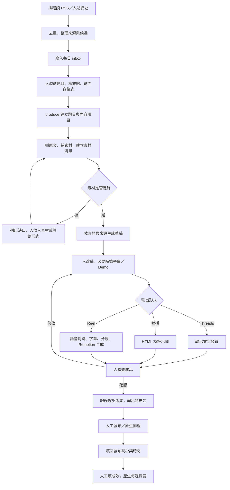
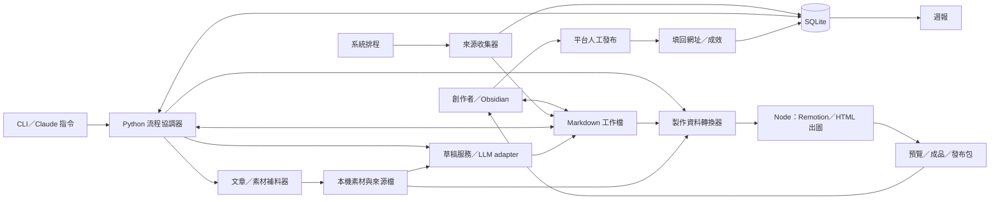

# AI Media Studio｜0 → 1 功能與架構交接

版本：v0.1｜日期：2026-10-17｜依據：[原始產線設計](05_Content_Pipeline_Design.md)

這份文件給接手實作的人使用。原文件保留工具研究與長期構想；本文件定義先做什麼、使用者怎麼操作、各模組怎麼交資料。這是實作提案，尚未代表功能已存在。

## 1. 產品要解決什麼

讓一個人能把 AI 科技情報，快速做成有來源、帶自己觀點的繁中貼文、輪播或短影音。人把時間花在選題、觀點與錄製，系統處理收集、整理、草稿與製作。

第一版先讓一則內容從頭走到底，再逐步減少人工操作。原設計的六小時出片是優化方向，不作為第一版的硬性驗收。

使用者只有創作者本人。PM 負責收斂功能與使用流程；SA 負責模組、資料與串接邊界，不需要另建團隊權限或審批系統。

## 2. 第一版範圍

| 這輪要有 | 後續再加 |
|---|---|
| 手動貼來源網址、RSS 收集、每日候選清單 | X List／書籤、社群熱度、競品監控 |
| 人選題、自動補官方文章與可取得的圖片／影片、人補素材 | 全平台下載備援、自動瀏覽器錄影 |
| 依素材生成繁中講稿、節奏表、圖卡文案與貼文說明 | 複雜事件聚類、進階推薦 |
| Threads 文字、固定輪播模板、固定 Reel 模板 | 3D、AI 影片、多套動畫模板 |
| 人工確認、人工發布、填回貼文網址與數據 | 自動發布、Insights API、自動成效排程 |
| 工作進度、錯誤與單步重跑 | 多人協作、雲端工作流平台 |

三種節目共用同一條產線，以不同草稿模板區分；先做 AI Today 模板，Tool Review 與 AI Engineering 可以先用人的筆記與自錄素材完成。模式 A／B 是素材來源差異，不另外開兩套系統。

## 3. 使用者操作面

保留「資料夾＋Markdown＋Obsidian」方式，第一版不另外做 Web 後台。指令先做成 CLI，再包成 Claude Code slash command；slash command 只是入口，實際工作由程式執行。

使用者日常看五個地方：

| 位置 | 使用者會做的事 |
|---|---|
| `inbox/YYYY-MM-DD.md` | 看候選、勾選題目、填觀點與想做的格式 |
| `topics/<topic_id>/topic.md`、`notes.md` | 調整節目、備註、看目前進度與缺什麼 |
| `topics/<topic_id>/media/raw/` | 放自己的錄影、旁白、截圖 |
| `topics/<topic_id>/contents/<content_id>/` | 改稿、看預覽、確認某一則成品 |
| `reports/weekly.md` | 看本週發了什麼、哪些內容值得繼續做 |

## 4. 完整 User Flow

### 使用者實際操作流程

以下以創作者的操作順序說明；不需要圖表渲染即可閱讀。

| 階段 | 我看到什麼 | 我要做什麼 | 系統回應／下一站 |
|---|---|---|---|
| 1. 開始使用 | 工作區與來源設定 | 首次填入追蹤的 RSS、個人口吻與常用名詞；平常也能直接貼一則網址 | 建立候選，進入每日清單 |
| 2. 找今天的題目 | inbox 內的標題、來源、發現時間與建議格式 | 看原文，略過不想做的題目；有興趣就勾選 | 保留選擇，等待我啟動製作；沒有想做的題目就結束本次操作 |
| 3. 決定怎麼講 | 被勾選的題目與備註欄 | 寫一句自己的角度，選節目與格式，例如「AI Today，先 Threads 再輪播」；執行 `/produce` | 建立一個題目、兩則內容，開始抓原文與素材 |
| 4. 看資料是否夠用 | 題目資料夾、來源摘要、素材清單與缺口 | 若資料足夠就繼續；若缺 Demo，放自己的錄影／截圖，也可以改做文字 | 更新素材清單，依實際可用資料出草稿；若缺必要資料，清楚停在待補料 |
| 5. 改草稿 | 講稿、節奏表、圖卡文案、貼文說明與引用 | 改觀點、修數字與口吻；不滿意則補 notes，再執行 `/redraft <content>` 並選用新稿 | 保留人工稿，另存新草稿；選定版本後進入製作 |
| 6. 補錄音與畫面 | Reel 節奏表中需要的旁白與 Demo | 要做 Reel 就錄旁白／操作畫面，放入 media/raw；文字與輪播可跳過錄製 | 盤點新素材，提示是否需要調整分鏡；等我啟動輸出 |
| 7. 產生成品 | 每則內容的選用稿件與素材 | Threads 產生文字預覽；輪播執行 `/carousel <content>`；影片執行 `/reel <content>` | 顯示進度，產生文字／圖片／影片預覽；失敗時顯示原因與重跑入口 |
| 8. 看成品與修改 | `/review <content>` 的預覽、來源與待確認項 | 檢查說法、字幕、畫面、素材用法；有問題回去改稿或換素材，再製作 | 產生新版本供我重看；確認後保存這次版本，輸出發布包 |
| 9. 發布 | 成品檔案與可複製的貼文說明 | 到平台手動發布或設定原生排程；實際發布後填回網址、平台與時間 | 記錄這一則作品在哪裡發布；同題其他內容繼續各自進行 |
| 10. 回看效果 | 已發布清單與成效填寫位置 | 填入可取得的播放與互動數據，執行 `/retro` | 產生週報，提出下次選題與內容形式建議，由我決定採用哪些 |

**日常主線：** 開 inbox → 選題與寫角度 → 補資料 → 改稿 → 製作 → 看預覽 → 確認 → 人工發布 → 記錄效果。

**修改回路：** 缺資料回補料；觀點不對回改稿；字幕或畫面有問題回製作；每次改動後重新看成品並確認。

### 流程圖（支援 Mermaid 的閱讀器可顯示）



### 每一步如何接續

| 步驟 | 觸發方式 | 系統動作與交給下一步的資料 |
|---|---|---|
| 收集 | 排程；或人執行 `add-source <url>` | 寫入來源資料、候選 ID、原始網址與首次發現時間 |
| 候選整理 | 收集完成 | 依網址／來源 ID 去重，產生 inbox；第一版允許人合併同事件候選 |
| 選題 | 人打勾後執行 `/produce` | 依候選 ID 建立或沿用 topic，建立選定的 content 項目 |
| 補料 | produce 內接續執行 | 存原文、素材與來源對照；失敗項目列出來，不讓整題消失 |
| 草稿 | 補料完成；或 `/redraft <content>` | 讀來源、素材、notes、voice，產出該則內容的稿件與引用 |
| 人工編輯 | 人直接改檔 | 程式保留人工內容；重生草稿另存新版本，供人選用 |
| 製作 | `/reel <content>` 或 `/carousel <content>` | 依已選稿件與素材產生成品；Threads 直接輸出文字 |
| 確認 | `/review <content>` 顯示預覽，人明確確認 | 記錄確認的成品版本；看過預覽不等於確認 |
| 發布 | 人在平台操作後執行 `mark-published` | 記錄 content、平台、貼文網址與實際發布時間 |
| 回饋 | 人填數據後執行 `/retro` | 依貼文彙整成效、產出調整建議，由人決定是否採用 |

打勾代表選題，不代表允許發布。第一版不監聽每次檔案修改自動跑昂貴工作，避免改稿時反覆生成；只有收集與 inbox 更新走排程。

## 5. 功能清單與實作順序

以下每批都能拿實際題目試用，不另外寫嚴格驗收表。

| ID | 功能 | 做到什麼程度即可先用 | 批次 |
|---|---|---|---|
| F01 | 工作區初始化 | 建立目錄、來源設定、口吻、名詞表；金鑰放環境變數 | 1 |
| F02 | 手動新增情報 | 貼網址與一句備註，加入候選 | 1 |
| F03 | RSS 收集與排程 | 定期收集設定來源，記住已處理項目 | 2 |
| F04 | 每日 inbox | 顯示來源、時間、建議節目／格式，保留人的勾選與備註 | 1 |
| F05 | 選題與建題 | 從勾選候選建立 topic，可選一則或多則內容 | 1 |
| F06 | 原文與素材補充 | 抓可取得的官方原文與直接素材；抓不到則請人補 | 1 |
| F07 | 素材盤點 | 記錄來源、類型、影片長度、可用片段與缺口 | 1 |
| F08 | 草稿生成與重生 | 依現有素材出稿、附引用；沒有根據的說法標成待確認 | 1 |
| F09 | 人工修改與補料 | 可改稿、放 Demo／旁白，明確指定何時重生 | 1 |
| F10 | Threads 發布包 | 輸出文字、來源與可選附件 | 1 |
| F11 | 輪播出圖 | 一套固定 HTML/CSS 模板，輸出圖片與預覽；溢版提示修改 | 2 |
| F12 | Reel 製作 | 一套 9:16 模板，串旁白、素材、字幕，Remotion 輸出 MP4 | 3 |
| F13 | 中文字幕 | 以實際錄音對時、名詞表校正，可人工修字幕與時間 | 3 |
| F14 | 成品確認與發布紀錄 | 確認版本、輸出發布包、填回各平台貼文網址 | 1；隨格式擴充 |
| F15 | 成效與週報 | 手填播放／互動等資料，產出簡單比較與建議 | 2 |
| F16 | 進度與重跑 | 顯示正在做、缺資料或失敗原因，可只重跑失敗步驟 | 1 起逐步補齊 |
| F17 | 熱度與外部來源擴充 | 加 S/A/B 建議、X 等來源；不阻擋手動選題 | 4 |

**批次 1：** 先用手動來源跑完「選題 → 草稿 → Threads 文字 → 人工發布 → 記錄」。

**批次 2：** 加 RSS、輪播與手動成效，開始減少日常整理時間。

**批次 3：** 加自錄音訊、字幕、固定 Reel 模板，完成影音閉環。

**批次 4：** 依實際耗時再接 X、熱度、更多補料方法與進階動畫。前面批次可以用人工補足，不等所有 API 都就緒。

## 6. 軟體架構

採單機、單使用者、模組化程式。Python 管流程與資料，Node/Remotion 管影音與出圖；不用先拆微服務、架訊息佇列或做帳號系統。



| 模組 | 責任 | 不由它決定的事 |
|---|---|---|
| 收集器 | 讀來源、標準化、去重、更新候選 | 哪題一定要製作 |
| 流程協調器 | 建工作、讀寫狀態、呼叫各步驟、處理重跑 | 內容觀點與發布決策 |
| 補料器 | 存來源全文、下載可取得素材、更新素材索引 | 把下載成功視為素材已可公開使用 |
| 草稿服務 | 依來源與素材出稿，留下引用與待確認項 | 自行補造缺失事實 |
| 製作資料轉換器 | 將節奏表、素材與字幕轉成結構化製作檔，檢查路徑與時間 | 在 render 時臨時請 LLM 改稿 |
| 渲染器 | 讀固定輸入，產出影片／圖片／預覽 | 收集、選題與發布 |
| 發布／回饋模組 | 記錄確認版本、貼文與成效，整理週報 | 自動改變策略或替人發布 |

Python 以 subprocess 呼叫 Node 製作指令，傳入 JSON 路徑；Node 回傳輸出路徑與成功／失敗結果。外部工具都包成 adapter，先能替換，不先做通用外掛平台。

## 7. 資訊流與資料歸屬

### 三種核心單位

- **Topic（題目）：** 一個事件或主題，共享來源與素材。
- **Content（內容）：** 題目下的一則作品，有自己的節目、格式、草稿、製作與確認狀態。例如同題有 Threads、輪播、解說 Reel。
- **Publication（發布）：** 作品發布到某平台的紀錄。同一 Reel 發 IG 與 YouTube，建立兩筆紀錄，各自收成效。

關係為 `Topic → 多個 Content → 多個 Publication`。原文件的 burst_plan 在本版展開為多個 Content，避免第一則發布後整個題目被誤認為完成。後續同題三波也可新增 Content，沿用來源與素材。

### 檔案與資料庫如何分工

| 資料 | 主要存放處 | 如何流到下一步 |
|---|---|---|
| 來源、候選、首次出現時間 | SQLite | 產生 inbox；使用穩定候選 ID 對應勾選 |
| 選題勾選、人的觀點 | inbox、notes.md | produce 讀取；刷新 inbox 不覆蓋人工區塊 |
| 題目與內容設定、人工稿件 | topic.md、content.md、script.md 等 | 每次指令開始重新讀檔，以人工修改為準 |
| 原文、素材 | sources/、media/ | 用 source_id、asset_id 對照來源與本機路徑 |
| 執行狀態與錯誤 | SQLite 的 jobs | 產生可閱讀的進度摘要；摘要狀態不接受手改作為命令 |
| 製作輸入 | shots.json、captions.json、manifest.json | 交給 Node 渲染，綁定同一次製作版本 |
| 確認、發布與成效 | SQLite | 匯出 publication.md 與週報供人看 |

Markdown 是人工內容的主資料；SQLite 是執行紀錄的主資料。SQLite 可以留內容索引，但不與 Markdown 各維護一份可編輯稿件。原始素材不覆寫；衍生檔另存。

### 建議資料夾

```text
newsroom/
  inbox/YYYY-MM-DD.md
  watchlist/sites.md
  voice.md
  glossary.md
  data/intel.db
  reports/weekly.md
  topics/<topic_id>/
    topic.md
    notes.md
    sources/<source_id>.md
    media/raw/                       # 官方下載與人放入的原檔
    media/gen/                       # 後續生成素材
    media/proc/                      # 衍生素材
    assets.json                      # 素材索引；media.md 為可讀摘要
    media.md
    contents/<content_id>/
      content.md                     # 節目、格式、選用稿件版本
      script.md                      # 講稿＋節奏表；影片使用
      carousel.md                    # 輪播文案；輪播使用
      caption.md                     # 發布文字
      drafts/<revision>/             # 重生草稿，先不覆蓋人工稿
      builds/<build_id>/
        shots.json
        captions.json
        manifest.json
        out/                         # 此版本成品與預覽
      publication.md                 # 確認與發布紀錄摘要
```

這是對原文件的最小結構調整：把每則作品的稿件與輸出移到 contents/，共享素材仍放 topic 底下。資料夾中的 ID 應固定，改標題不改 ID。

### 模組交接需要的最少欄位

| 物件／檔案 | 最少欄位 |
|---|---|
| Source | source_id、url、作者／發布者、published_at（可空）、first_seen_at、local_path |
| Topic | topic_id、title、source_ids、notes_path |
| Content | content_id、topic_id、program、format、selected_revision |
| Asset | asset_id、source_id（自錄可空）、origin（官方／自錄／第三方）、path、type、duration（適用時）、使用註記 |
| Job | job_id、content_id 或 topic_id、step、status、input_revision、output_paths、error |
| shots.json | shot_id、asset_id 或模板名、來源裁切起訖、時間軸起點、長度、講稿／圖卡文字 |
| captions.json | text、start_ms、end_ms、強調詞；時間相對於成品起點 |
| manifest.json | build_id、content_id、稿件版本、素材路徑、shots／captions 路徑、輸出規格 |
| Publication | publication_id、content_id、build_id 或文字版本、platform、url、published_at |
| MetricSnapshot | publication_id、captured_at、各指標數值（無資料為空，不當成 0） |

稿件的重要數字與說法附 source_id；分鏡引用 asset_id；素材再回指 source_id。如此從成品能回到素材與原文。LLM 建議的分鏡須先轉成可解析 JSON，檔案不存在或裁切超過片長就提示修改，不直接交給渲染器猜。

第一版資料表以 sources、candidates、topics、contents、assets、jobs、approvals、publications、metric_snapshots 為主；候選／題目與來源之間用關聯表保存對應。

## 8. 狀態、人工回路與例外

完整 UML 狀態圖與可編輯原始碼見 [Pipeline 狀態圖](../spec/08_state_machines.md)，分別說明 Content、Job 與 Publication。


內容進度：`drafting → review → producing → ready → approved → published`。Threads 可從 review 直接到 ready；published 表示至少有一筆實際發布紀錄，各平台進度另外看 Publication。Topic 只彙整旗下 Content，不共用單一發布狀態。

工作執行狀態另外記：`queued / running / succeeded / blocked / failed`。例如某則內容仍在 drafting，但補料 Job 可以是 blocked，原因是缺 Demo。

| 情況 | 第一版怎麼處理 |
|---|---|
| 同題再按 produce | 用候選 ID 找回 topic；不重建相同內容，不重複扣生成費 |
| 稿件重生 | 另存 drafts 新版本，人選用後才進入製作 |
| 補料抓不到 | 列出缺口；人補檔、換素材或改做文字／輪播後繼續 |
| 沒有錄音 | 影片工作停在待補錄音；先支援自錄旁白，不預設接 TTS |
| 錄音與稿件不同 | 字幕以實際說話內容對時，講稿與名詞表輔助校正，差異提示人修正 |
| API／LLM／渲染失敗 | 記錄原因，可重跑該步；成功輸出保留，不整條重跑 |
| 稿件、素材或字幕改了 | 相關成品標示需重製；新版本重新確認，舊發布紀錄仍指向原版本 |
| API 未申請或額度不足 | 顯示未啟用／暫停，繼續用手動網址與人工素材 |
| 未確認來源或素材用法 | 在 review 顯示待確認項，讓人修改或明確處理後再確認 |

同一時間先一次執行一個製作工作；以 Job 鎖避免同一內容重複執行。中斷後將未完成工作標為可重跑，無須第一版就做分散式排程。

## 9. 接手的人從哪裡開始

1. 建立 Python CLI、SQLite 與 newsroom 初始化，先用手動網址建立一筆候選。
2. 做 inbox → produce → 補料 → 草稿，拿一個真實題目直接修改試用。
3. 做文字預覽、版本確認、發布紀錄，先人工發布一則 Threads。
4. 依功能表批次加入 RSS、輪播、成效，再接 Reel；每批保留一個可重跑的實際範例。

開發時只檢查幾件實用的事：同一題不會重複建立、人工修改不會被吃掉、失敗能從該步繼續，以及產出的內容能實際拿去發。影音階段再檢查字幕對時、圖卡是否溢版與影片是否可播放，不先建大型驗收制度。

外部 API 權限、價格、工具可用性與平台規格，沿用原文件作為研究線索，接入該項功能前再查官方文件及實測；本文件不把那些未驗證資訊當成已成立的架構前提。
