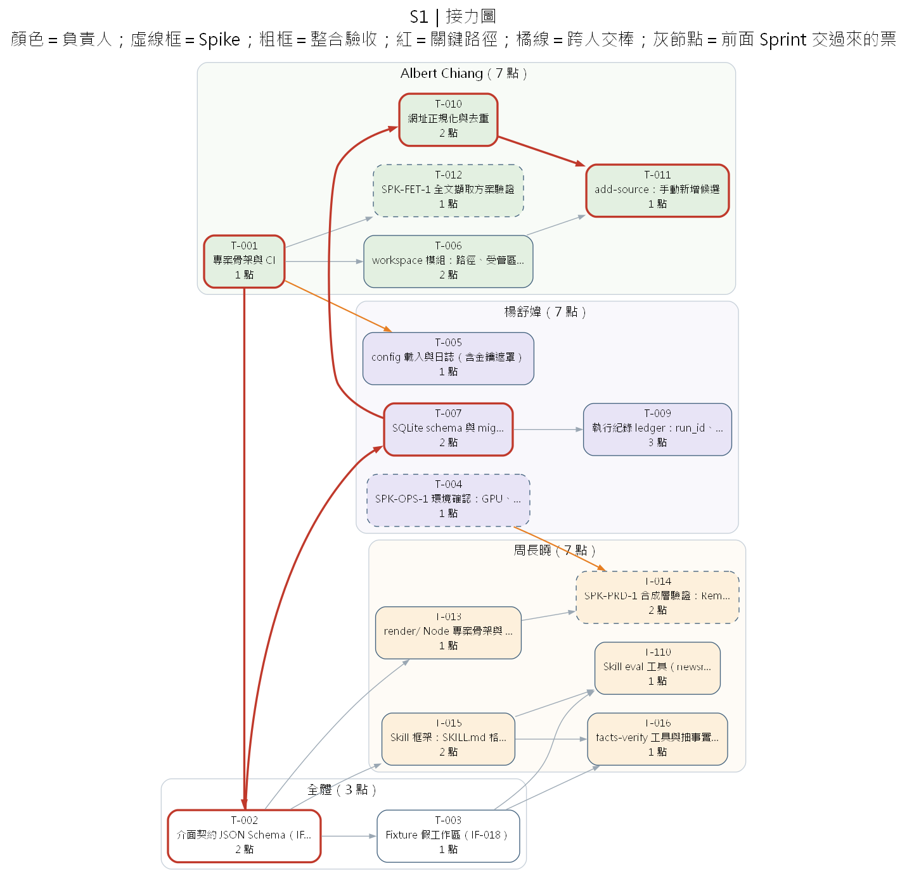
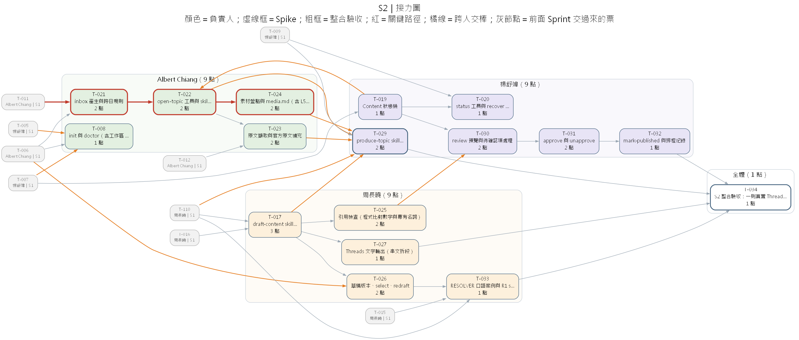
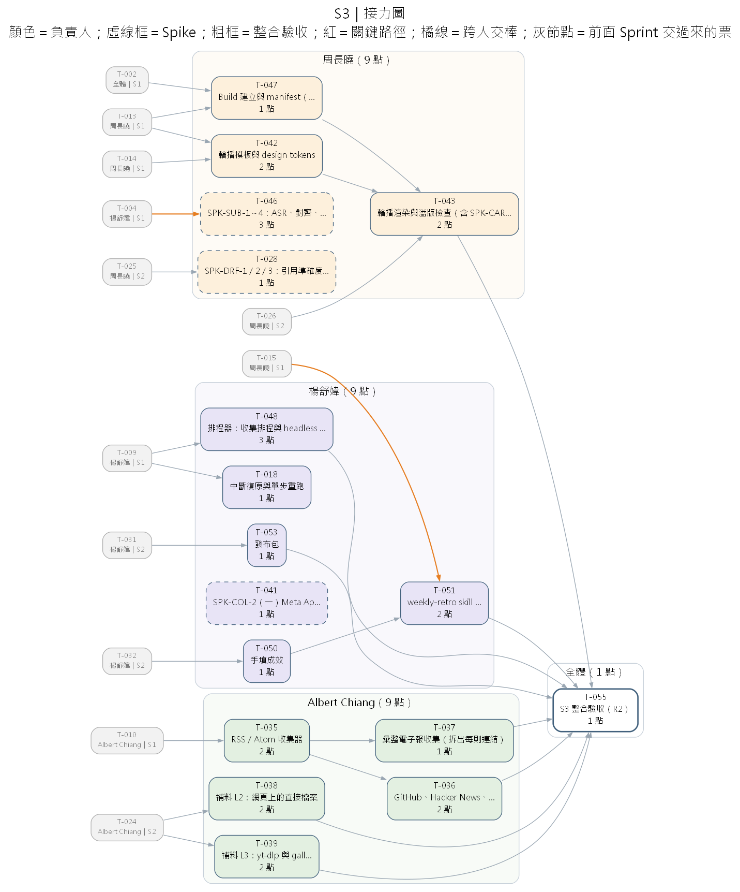
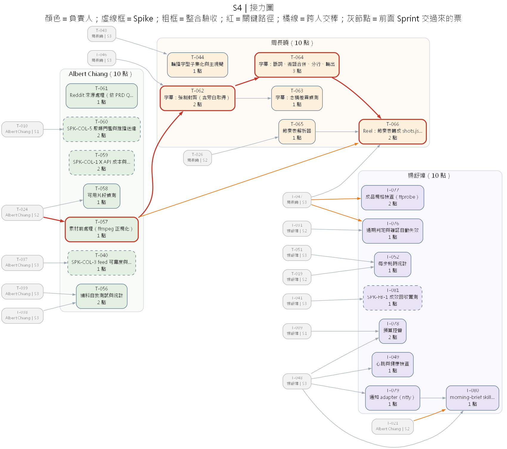
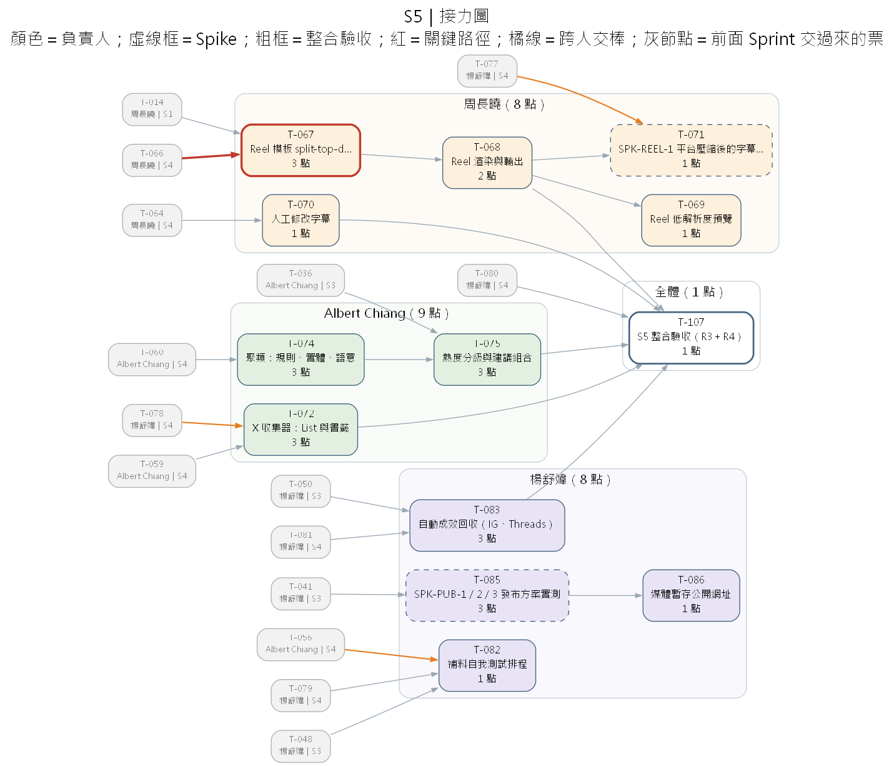
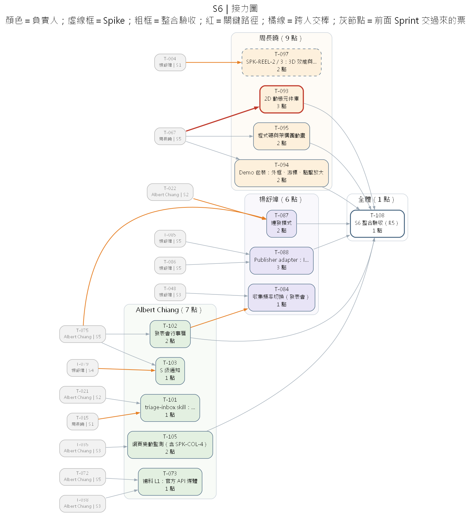
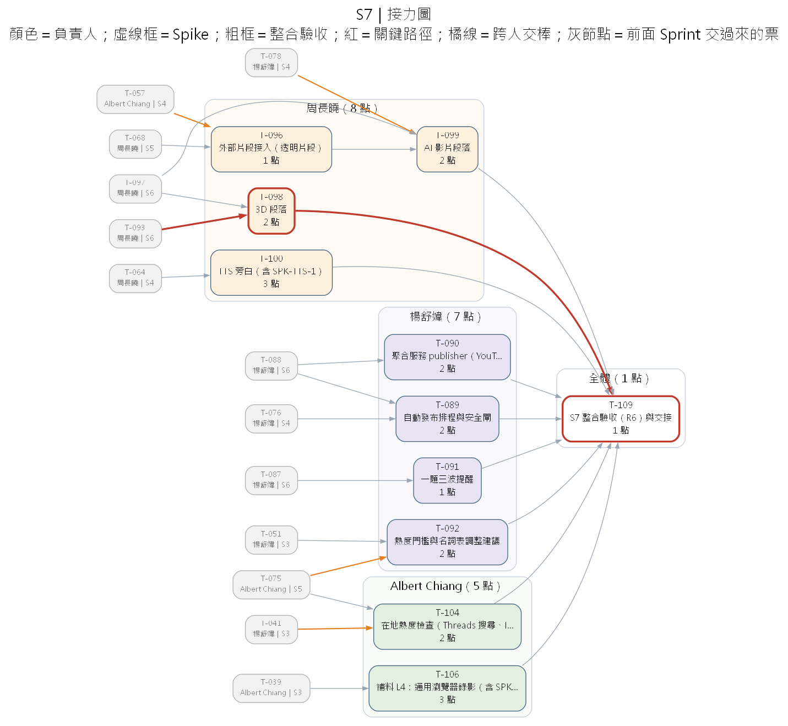

# 分工、DAG 與 Sprint 計畫

| 項目 | 內容 |
|---|---|
| 版本 | v1.0｜2026-10-23 |
| 節奏 | 兩週一個 Sprint，三人全職；共 **7 個 Sprint（14 週）** |
| 單一資料來源 | `tickets/T-*.md` 的 front-matter（負責人、Sprint、估點、前置票） |
| 產生方式 | `python docs/tools/build_dag.py` → 檢查依賴、循環、需求覆蓋與負載，並產生 `tickets/README.md` 與 `diagrams/dag*.png／svg` |

---

## 1. 為什麼是 7 個 Sprint

照 SRS 拆票後共 107 張、179 點（1 點＝1 人天；「全體」的票每人各計一次）。每人約 60 點，換算如下：

| 方案 | 每人容量 | 結果 |
|---|---|---|
| 6 個 Sprint | 60 點 | 每人剛好排滿，完全沒有緩衝；周長曉會超載 |
| **7 個 Sprint** | 70 點 | 每個 Sprint ≤ 10 點，S6、S7 有緩衝，可以吸收 Spike 結果帶來的變動 |

如果要壓回 6 個 Sprint，建議把 R6 裡標「C」（可以）的項目移到 backlog：3D 段落、AI 影片段落、TTS、一題三波、調整建議。

## 2. 分工

### 2.1 模組歸屬

| 人 | 角色 | 擁有的模組 | 交出去的東西 |
|---|---|---|---|
| **Albert Chiang** | 素材收集 | 工具介面骨架、workspace、init；collect（所有收集器、正規化、聚類、熱度、inbox、建題、行事曆）；fetch（原文、L1–L4 補料、素材盤點、前處理、自我測試）；skills：open-topic、gather-assets、triage-inbox | inbox、topic／content、sources/*.md、assets.json、media/proc |
| **周長曉** | 產出文章、剪輯影片 | skill 框架（SKILL.md 格式、RESOLVER、eval 工具）；draft（facts 驗證、寫稿 skill、引用檢查、版本、Threads）；production（Build、輪播、字幕、Reel 模板與渲染、動畫層、TTS）；render/ Node 專案；skills：draft-content、make-carousel、make-subtitles、make-reel | drafts/、script／carousel／caption、captions.json、shots.json、builds/ |
| **楊舒媁** | 自動排程與發布 | config／log、SQLite schema、執行紀錄 ledger（run_id、冪等、鎖）、狀態機、工具層關卡、status；排程器與 headless 執行、心跳、通知、預算；skills：produce-topic、review-and-approve、publish、recover、morning-brief、weekly-retro；review、approve、過期判定、規格檢查、發布包、發布紀錄、自動發布；成效、週報、建議；Meta App 與平台權限 | Job API、approvals、publications、metric_snapshots、reports/ |

**為什麼這樣切**
- 每個人擁有一段完整的流水線：收集 → 製作 → 發布。交棒點剛好是人工決策點（選題、選稿、確認），責任清楚。
- 周長曉的範圍最大，所以把「跟發布品質有關」的規格檢查、過期判定交給楊舒媁，把「素材處理」的前處理交給 Albert。
- 核心層拆給兩個人：Albert 負責檔案（workspace），楊舒媁負責執行（Job、狀態、資料庫）。兩邊在 S1 就要交棒。

### 2.2 RACI（R＝負責，A＝當責，C＝諮詢，I＝告知）

| 工作 | Albert | 周長曉 | 楊舒媁 | 主管 |
|---|---|---|---|---|
| 介面契約（07）與 fixtures | R | R | R | A |
| 收集、補料 | R/A | C | I | I |
| 草稿、輪播、字幕、Reel | I | R/A | C | I |
| Job、排程、通知、預算 | C | C | R/A | I |
| 確認、發布、成效 | I | C | R/A | I |
| Spike 結論與工具選擇 | R（自己的模組） | R（自己的模組） | R（自己的模組） | A |
| PRD 待決事項（Q1–Q5） | C | C | C | A |
| 每個 Sprint 的整合驗收 | R | R | R | A |

## 3. 接力方式

### 3.1 原則

1. **契約先行**：S1 第一週三人一起寫完 JSON Schema（T-002）與 fixtures（T-003）。下游拿 fixture 就能開工，不必等上游真的做完。
2. **交棒的定義**：上游的輸出通過 schema 驗證、合併進 main，並在站會上說「T-xxx 已交棒」。下游當天就把自己的測試從 fixture 切換成真實資料。
3. **同 Sprint 內的交棒排在前幾天**：上游的票如果有下游在同一個 Sprint 等，就排在那個 Sprint 的第一、二天做。
4. **整合驗收是全體的票**：每個 Release 結束時，三人一起用一則真實題目走一遍；發現的問題當場開票。

### 3.2 全部跨人交棒點

橘色箭頭就是這些交棒。標 ⚡ 的是**同一個 Sprint 內**的交棒，上游要排在 Sprint 的前段完成。

| Sprint | 上游（交出） | → | 下游（接手） | 交棒物 |
|---|---|---|---|---|
| S1 ⚡ | T-001 專案骨架（Albert） | → | T-005 config 與日誌（楊舒媁） | repo 結構 |
| S1 ⚡ | T-007 SQLite schema（楊舒媁） | → | T-010 網址正規化（Albert） | sources 資料表 |
| S1 ⚡ | T-004 環境確認（楊舒媁） | → | T-014 合成層 Spike（周長曉） | GPU 結論 |
| S1 ⚡ | T-015 skill 框架、T-110 eval 工具（周長曉） | → | S2 所有 skill 票（三人） | SKILL.md 格式、IF-020、`newsroom eval` |
| S2 | T-005、T-007（楊舒媁） | → | T-008 init／doctor（Albert） | config、migration |
| S2 ⚡ | T-019 狀態機（楊舒媁） | → | T-022 建題（Albert） | Content 狀態 |
| S2 | T-006 workspace（Albert） | → | T-026 草稿版本（周長曉） | 受管區塊、原子寫入 |
| S2 ⚡ | T-022、T-023、T-024（Albert）；T-017（周長曉） | → | T-029 produce-topic skill（楊舒媁） | open-topic、gather-assets、draft-content skill 與工具 |
| S2 ⚡ | T-025 引用檢查（周長曉） | → | T-030 review（楊舒媁） | citations.json |
| S3 | T-004（楊舒媁） | → | T-046 字幕 Spike（周長曉） | GPU 結論 |
| S3 | T-015 skill 框架（周長曉） | → | T-051 weekly-retro skill（楊舒媁） | SKILL.md 格式 |
| S4 ⚡ | T-057 素材前處理（Albert） | → | T-062 對齊、T-066 shots（周長曉） | media/proc、旁白 wav |
| S4 | T-047 Build（周長曉） | → | T-076 過期判定、T-077 規格檢查（楊舒媁） | manifest.json |
| S4 | T-021 inbox（Albert） | → | T-080 早報（楊舒媁） | 候選查詢 |
| S5 | T-077 規格檢查（楊舒媁） | → | T-071 平台壓縮 Spike（周長曉） | 檢查器 |
| S5 | T-078 預算（楊舒媁） | → | T-072 X 收集器（Albert） | 預算控管 |
| S5 | T-056 自我測試（Albert） | → | T-082 自我測試排程（楊舒媁） | selftest 指令 |
| S6 ⚡ | T-102 行事曆（Albert） | → | T-084 頻率切換（楊舒媁） | events 資料表 |
| S6 | T-075 熱度分級、T-022 建題（Albert） | → | T-087 連發模式（楊舒媁） | tier、建題 API |
| S6 | T-004（楊舒媁） | → | T-097 3D／AI Spike（周長曉） | GPU 結論 |
| S6 | T-015（周長曉）、T-078（楊舒媁） | → | T-101 標題翻譯（Albert） | LLM、預算 |
| S6 | T-079 通知（楊舒媁） | → | T-103 S 級通知（Albert） | notifier |
| S7 | T-075（Albert） | → | T-092 調整建議（楊舒媁） | 分數明細 |
| S7 | T-057（Albert） | → | T-096 外部片段（周長曉） | 前處理 |
| S7 | T-078（楊舒媁） | → | T-099 AI 影片（周長曉） | 預算控管 |
| S7 | T-041 Meta App（楊舒媁） | → | T-104 在地熱度（Albert） | 權限與 token |

### 3.3 關鍵路徑

`build_dag.py` 算出的最長依賴鏈共 31 點：

> T-001 骨架 → T-002 契約 → T-007 SQLite → T-010 正規化 → T-011 add-source → T-021 inbox → T-022 建題 → T-024 素材盤點 → T-057 素材前處理 → T-062 對齊 → T-064 斷詞分行 → T-066 shots → T-067 Reel 模板 → T-093 2D 元件 → T-098 3D → T-109 R6 驗收

觀察：
- 前半段幾乎都在 Albert 身上（S1–S4），**Albert 的票延誤，後面全部延誤**。S1、S2 的站會先看他的進度。
- 後半段在周長曉身上（字幕 → Reel → 動畫）。
- 31 點遠小於 7 個 Sprint 的 70 個工作天，所以瓶頸是人力負載，不是依賴鏈；有餘裕吸收單張票延誤。

## 4. DAG 圖

每個 Sprint 一張泳道圖，依負責人分道。灰色節點是前面 Sprint 交過來的票，橘線是跨人交棒，紅線是關鍵路徑，虛線框是 Spike，粗框是整合驗收。

| Sprint | 圖 |
|---|---|
| S1 |  |
| S2 |  |
| S3 |  |
| S4 |  |
| S5 |  |
| S6 |  |
| S7 |  |

全專案的總圖在 [diagrams/dag.svg](../diagrams/dag.svg)，請用瀏覽器開啟並放大查看。

## 5. Sprint 計畫

| Sprint | 週 | Sprint 目標 | Release | Albert | 周長曉 | 楊舒媁 |
|---|---|---|---|---|---|---|
| S1 | 1–2 | 契約與 fixtures 定稿；骨架、workspace、資料庫、執行紀錄 ledger；skill 框架與 eval 工具；手動加候選；合成層與擷取 Spike；facts 驗證 | — | 10 | 10 | 10 |
| S2 | 3–4 | 用口語對 agent 下需求：inbox → produce-topic（建題、擷取、草稿）→ review → 確認 → 發布紀錄，一則真實 Threads 走完 | **R1** | 10 | 10 | 10 |
| S3 | 5–6 | RSS、GitHub、HN、HF、電子報；L2／L3 補料；輪播；排程器與 headless skill 執行；手填成效與 weekly-retro；字幕 Spike；Meta App 送審 | **R2** | 10 | 10 | 10 |
| S4 | 7–8 | 字幕全流程；shots 轉換；過期判定與規格檢查；預算、通知、早報；X、聚類 Spike | — | 10 | 10 | 10 |
| S5 | 9–10 | Reel 模板與渲染；X 收集、聚類、熱度分級；自動成效回收；發布 Spike | **R3＋R4** | 10 | 9 | 9 |
| S6 | 11–12 | 動畫層（2D、Demo 包裝、程式碼）；變動監測；行事曆、S 級通知；連發；IG／Threads 發布 adapter | **R5** | 8 | 10 | 7 |
| S7 | 13–14 | 自動發布；聚合服務；3D／AI 段落；TTS；在地熱度；L4 錄影；一題三波；交接 | **R6** | 6 | 9 | 8 |

負載數字由 `build_dag.py` 計算（含「全體」的票），每次改票後重跑即可更新 [tickets/README.md](../tickets/README.md)。

**PRD 的 Release 對應調整**：PRD §6 原本是 R1–R6 各對應一個 Sprint；實際排程後是 R1＝S2、R2＝S3、R3 與 R4＝S5、R5＝S6、R6＝S7。

## 6. 主管要盯的決策點

| 時間 | 決策 | 依據的票 | PRD |
|---|---|---|---|
| **2026-10-30 前** | 要不要趕在 Reddit 停止受理前登記 API app（[申請步驟](../runbooks/reddit-api-access.md)） | — | Q5 |
| S1 第一週 | GPU 是否可用 | T-004 | Q1 |
| S1 結束 | Remotion 技術驗證通過與否（授權 POC 不處理，PRD D14） | T-014 | — |
| S3 起 | Meta App 權限送審（審核要時間，越早越好） | T-041 | — |
| S4 結束 | X API 方案與預算上限 | T-059 | Q2 |
| S5 結束 | 自動發布走官方 API 或聚合服務 | T-085 | Q3 |
| S6 結束 | 3D、AI 影片要不要做 | T-097 | — |

## 7. 協作規則

### 7.1 票的生命週期

`todo → doing → review → done`（改 front-matter 的 `status`，再重跑 `build_dag.py`）

- **Definition of Ready**：前置票都是 done（或可以先用 fixture）；驗收標準清楚；需要的金鑰或帳號已備妥。
- **Definition of Done**：驗收標準全部通過；有測試而且在 CI 通過；輸出通過 schema 驗證；文件（docs/ 或 SRS）已同步；至少一位其他成員 review 過 PR。

### 7.2 Git

- 分支：`<type>/<ticket-id>-<short-description>`，例如 `feat/t-021-inbox`。完整規則（main／dev／功能分支、Sprint 合併、tag、保護規則）見 [06 分支策略](branching-strategy.md)。
- Commit：Conventional Commits，例如 `feat(collect): generate daily inbox`。
- PR 標題帶票號；PR 描述列出驗收標準的勾選結果。
- 修改 `schemas/` 的 PR 必須三人都 approve（SRS 07 修改規則）。

### 7.3 每日站會（15 分鐘）

1. 先看關鍵路徑上的票。
2. 每個人回答：今天要交棒什麼、在等誰的什麼。
3. 被卡住超過半天的事，當場決定改用 fixture 繼續，或調整順序。

### 7.4 Sprint 儀式

| 儀式 | 時間 | 產出 |
|---|---|---|
| Sprint Planning | 第 1 天，1 小時 | 確認本 Sprint 的票、同 Sprint 交棒的順序 |
| 整合驗收（Demo） | 最後一天上午 | `docs/releases/Rn.md` |
| Retro | 最後一天下午，30 分鐘 | 調整估點與流程；更新票 |

## 8. 風險與緩衝

| 風險 | 影響 | 對策 |
|---|---|---|
| S1 契約定不下來 | 三人都卡住 | T-002 限 S1 前 3 天完成；爭議由主管當天仲裁 |
| Albert 在關鍵路徑上延誤 | 全專案延誤 | S1–S2 每天先看他的票；必要時把 T-012 Spike 交給楊舒媁 |
| Spike 結論推翻原設計（例如 Remotion、X API） | 後續票要改 | S6、S7 留有緩衝；Spike 結論出來後立刻改票並重跑 DAG |
| 平台審核延遲（Meta 權限） | 在地熱度、自動發布延後 | T-041 在 S3 就送審；未通過時相關票順延，不擋主線 |
| 真實資料與 fixture 差異大 | 整合時才爆 | 每個 Sprint 的整合驗收用真實題目；發現差異就更新 fixtures |
