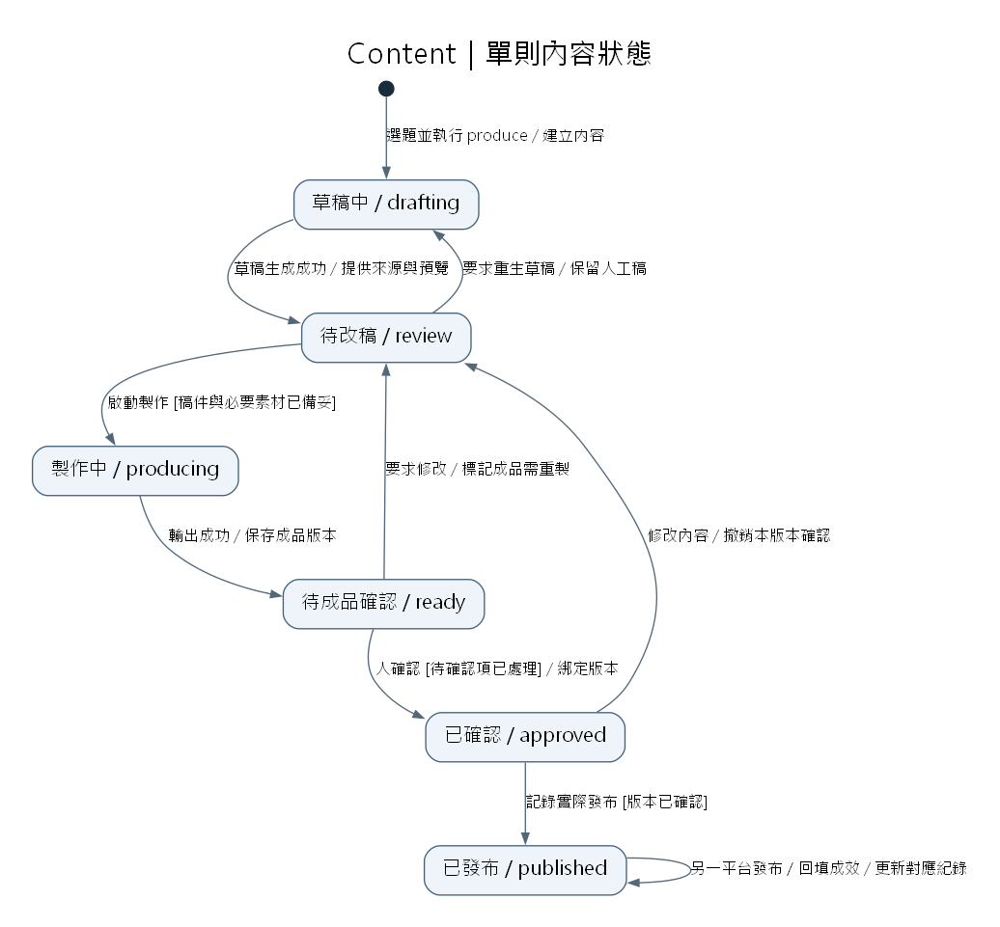
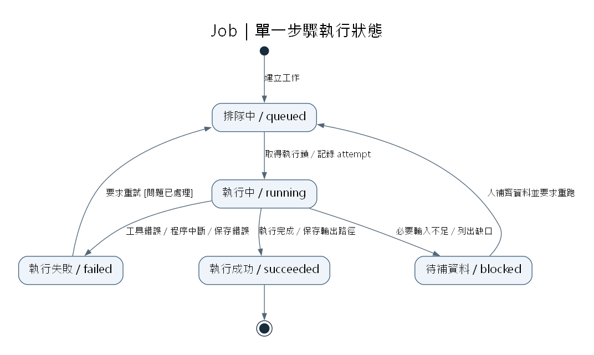
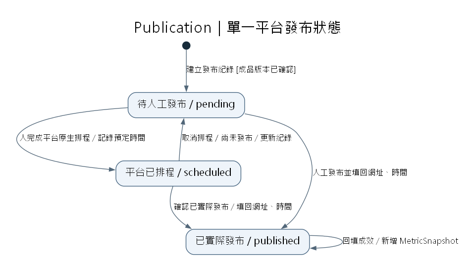

# Content Pipeline｜UML 狀態圖

依據 [MVP 交接文件](../archive/06_Content_Pipeline_MVP_Handoff.md)。圖片直接嵌入，不依賴 Mermaid。可編輯的 PlantUML 原始碼放在 [diagrams](../diagrams)。

箭頭標示採 UML 的 `事件 [條件] / 動作`；黑點為起始，雙圈為結束。狀態以個別物件為單位，Topic 只彙整旗下 Content 的進度。

## 1. Content：單則內容的生命週期

同一題的 Threads、輪播與 Reel 各自擁有一組狀態。Threads 仍需輸出文字預覽，才進入 ready。published 代表至少有一筆實際發布紀錄，不代表所有平台都已發布。

已發布作品要修改時，建立新內容版本進入 drafting；原版本及其發布紀錄保留。未發布版本若修改稿件、素材或字幕，原確認失效，重新製作及確認。

## 2. Job：單一步驟的執行狀態

補料、草稿生成、字幕、渲染各自建立 Job。缺錄音是 blocked，工具執行錯誤是 failed；兩者都不等於整則內容失敗。重試只執行該步，保留先前成功輸出，記錄新的 attempt。

## 3. Publication：單一平台的發布紀錄

此圖補充第一版的發布狀態。平台原生排程以 scheduled 記錄，只有確認已實際發布並填回網址、時間後才成為 published。每個平台各建一筆紀錄；成效回填是 published 的內部事件，不會讓貼文離開已發布狀態。

## 狀態如何串接

| 觸發 | 狀態影響 |
|---|---|
| produce 建立內容 | Content 進入 drafting，補料／草稿 Job 依序執行 |
| 草稿 Job 成功 | Content 進入 review |
| 製作 Job 成功 | Content 進入 ready；失敗則保留 producing，從 Job 看原因與重跑 |
| 人確認成品 | Content 進入 approved，確認綁定 build 或文字版本 |
| 人準備發布到某平台 | 為已確認版本建立 Publication，初始為 pending |
| 回填實際發布 | Publication 進入 published；Content 首次發布時進入 published |
| 回填成效 | 更新該 Publication 的 MetricSnapshot，Content 狀態不變 |

人工選題前的候選收集屬於輸入流程，不混入 Content 狀態；打勾選題也不等於批准發布。
